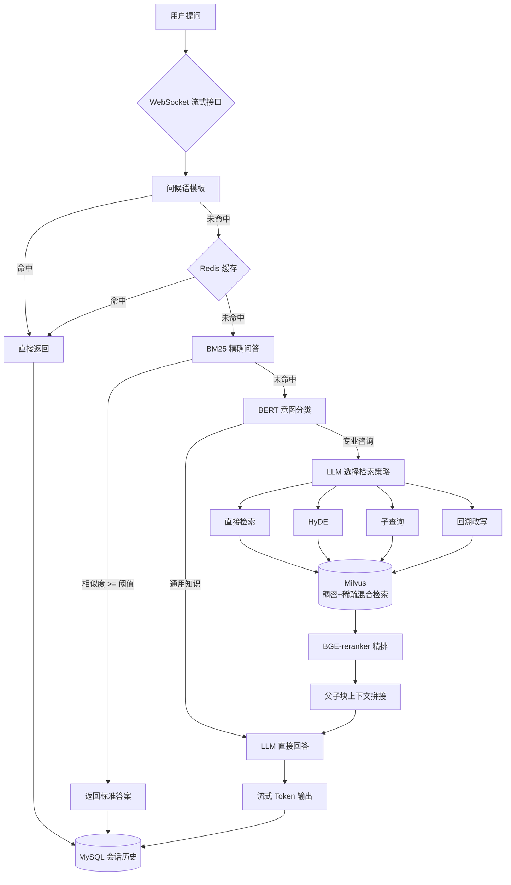

# EduRAG · 教育领域智能问答系统

面向 IT 培训场景的课程咨询问答系统。整个链路是「多格式文档解析 → 父子块切分 → 混合向量检索 → 重排序 → 意图路由 → 大模型生成」，并叠加了一层「Redis 缓存 → MySQL 精确问答 → RAG 兜底」的短路设计：能命中的问题毫秒级返回，命不中的才走完整 RAG。

## 核心特性

**1. 混合检索 + 两阶段排序**
BGE-M3 同时产出稠密向量（语义）和稀疏向量（关键词），在 Milvus 内用 `hybrid_search` + `WeightedRanker(1.0, 0.7)` 融合召回，再用 BGE-reranker-large 做 CrossEncoder 精排。稀疏通道解决了纯向量检索对专有名词、课程代码不敏感的问题。

**2. 父子块（Small-to-Big）召回**
父块 500 字、子块 100 字。子块建索引保证语义粒度细，命中后回溯父块喂给 LLM 保证上下文完整，避免"切开的一句话无法回答"。见 `rag_qa/core/document_processor.py`。

**3. BERT 意图路由**
自训 `bert-base-chinese` 二分类器（通用知识 / 专业咨询）。通用问题直连 LLM 不检索，专业问题才走 RAG，省一次检索开销也避免答非所问。训练数据在 `rag_qa/classify_data/`。

**4. 查询自适应检索策略**
由 LLM 针对 query 选择四种策略之一：直接检索 / HyDE（假设答案检索）/ 子查询拆分 / 回溯问题改写。见 `rag_qa/core/strategy_selector.py`。

**5. 流式输出**
FastAPI + WebSocket，逐 token 推送，前端边收边渲染。首 token 即可见，不等全文。

**6. 多格式文档解析**
PDF（含扫描件 OCR）、DOCX、PPTX、图片、Markdown 统一入库。PDF 中对大幅插图按宽高占比阈值（0.6）触发 OCR，并对旋转页做自动校正，兼顾速度与覆盖率。

**7. 评估与压测闭环**
RAGAS 四指标离线评估（`rag_qa/rag_assesment/`），Locust 压测记录首 token 延迟与 token 间隔（`locust_test.py`）。

## 架构



离线链路：`文档 → OCR/解析 → 父子切分 → BGE-M3 编码 → Milvus 入库`。

## 技术栈

| 层次 | 选型 |
| --- | --- |
| Web 框架 | FastAPI + Uvicorn + WebSocket |
| 向量库 | Milvus 2.4（IVF_FLAT + SPARSE_INVERTED_INDEX 双索引） |
| Embedding | BGE-M3（稠密 1024 维 + 稀疏权重） |
| 重排序 | BGE-reranker-large（CrossEncoder） |
| 意图分类 | bert-base-chinese 微调，PyTorch + Transformers |
| 关键词检索 | rank-bm25 + jieba 分词 |
| 缓存 / 结构化存储 | Redis 7 / MySQL 8 |
| 大模型 | 阿里云百炼 Qwen-Plus（OpenAI 兼容接口） |
| 文档解析 | PyMuPDF、python-docx、python-pptx、RapidOCR、OpenCV |
| 评估 / 压测 | RAGAS、Locust |

## 目录结构

```
.
├── app.py                    # FastAPI 入口：HTTP / WebSocket / 静态页面
├── new_main.py               # 集成问答系统：缓存 → BM25 → RAG 三级路由
├── base/                     # 配置加载（config.ini + .env）、日志
├── mysql_qa/                 # MySQL 问答库 + Redis 缓存 + BM25 检索
│   ├── db/mysql_client.py    # 建表与种子数据导入
│   ├── cache/redis_client.py
│   └── retrieval/bm25_search.py
├── rag_qa/                   # RAG 核心
│   ├── core/
│   │   ├── vector_store.py       # Milvus 建表、混合检索、rerank
│   │   ├── new_rag_system.py     # 检索策略编排 + 流式生成
│   │   ├── document_processor.py # 父子块切分
│   │   ├── query_classifier.py   # BERT 意图分类（含训练逻辑）
│   │   └── strategy_selector.py  # LLM 选策略
│   ├── edu_document_loaders/     # PDF/DOCX/PPTX/图片 OCR 加载器
│   ├── edu_text_spliter/         # 中文递归切分器
│   ├── rag_assesment/            # RAGAS 评估脚本与结果
│   ├── classify_data/            # 意图分类训练数据
│   └── models/                   # 本地模型权重（不入库，见下文）
├── static/index.html         # 单页前端（流式对话界面）
├── docker/                   # Milvus+Redis、MySQL 的 compose 编排
├── locust_test.py            # 压测脚本
└── archive/                  # 早期版本与教学练习，不参与运行
```

## 快速开始

**前置**：Python 3.10+、Docker Desktop，建议 16G 内存（首次加载模型约占 8G）。

```bash
# 1. 启动中间件
docker compose -f docker/milvus_redis/docker-compose.yml up -d
docker compose -f docker/mysql/docker-compose.yml up -d

# 2. 依赖与配置
python -m venv .venv
.venv\Scripts\activate           # mac/Linux: source .venv/bin/activate
pip install -r requirements-windows.txt   # mac 用 requirements-mac.txt
copy .env.example .env            # 填入 MySQL 密码与 DASHSCOPE_API_KEY

# 3. 导入 MySQL 问答库（建表 + 写入 1600+ 条种子问答）
python mysql_qa/db/mysql_client.py

# 4. 准备模型（见下方"模型准备"）

# 5. 文档入库（解析 rag_qa/data/ai_data 并写入 Milvus）
python -m rag_qa.core.vector_store

# 6. 启动服务
python app.py
```

访问 `http://localhost:8003`，浏览器打开即为对话界面；接口文档在 `/docs`。

**模型准备**：以下权重体积较大，未纳入仓库，需自行下载后按目录放置。

| 路径 | 用途 |
| --- | --- |
| `rag_qa/models/bge-m3/` | 稠密 + 稀疏向量编码 |
| `rag_qa/models/bge-reranker-large/` | 重排序 |
| `rag_qa/models/nlp_bert_document-segmentation_chinese-base/` | 语义切分（可选） |
| `rag_qa/core/bert_query_classifier/` | 意图分类器；重训方法见 `rag_qa/core/query_classifier.py` 的 `__main__`，数据在 `rag_qa/classify_data/` |

## 效果评估

RAGAS 离线评估，30 条人工构造的课程咨询问题（`rag_qa/rag_assesment/rag_evaluate_data.json`）：

| 指标 | 得分 | 说明 |
| --- | --- | --- |
| faithfulness | 0.908 | 答案是否忠实于检索到的上下文 |
| answer_relevancy | 0.868 | 答案与问题的相关程度 |
| context_recall | 0.975 | 上下文是否覆盖了标准答案所需信息 |
| context_precision | 1.000 | 见下方说明，区分度有限 |

**关于指标的诚实说明**：评测集仅 30 条，且 context_precision 恒为 1.0——因为评测样本的上下文基本就是标注答案所在段落，该指标在这个规模下没有区分度，不宜作为效果论据。faithfulness 与 answer_relevancy 更能反映实际表现。扩充评测集、做多档检索策略的消融对比是当前的首要 TODO。

**性能实测**（Locust，128 次请求，CPU 推理，无 GPU）：

| 指标 | P50 | P95 |
| --- | --- | --- |
| 首 token 延迟 | 5.8 s | 13.1 s |
| 完整响应耗时 | 115 s | 180 s |

瓶颈明确在 CPU 上跑 BGE-M3 + reranker，以及每次查询额外一次"选策略"的 LLM 调用。换 GPU 或换更小的 reranker 是下一步优化方向。

## 已知限制

- 服务端为单例对象，MySQL 连接与游标在多个请求间共享，高并发下需改为连接池。
- `prompt_input[:4096]` 采用硬截断，极端超长场景会截掉问题本身，应改为按块优先级裁剪。
- 策略选择依赖 LLM 输出格式，解析失败时回退到"直接检索"，稳定性弱于规则/小模型分流。
- `allow_origins=["*"]` 与无鉴权的接口仅适用于演示环境。
- BM25 阈值基于 softmax 归一化分数，其物理含义为分布概率而非相似度，阈值取值需通过扫参确定。

## 说明

知识库与问答语料仅用于教学与演示，不含真实客户数据。
